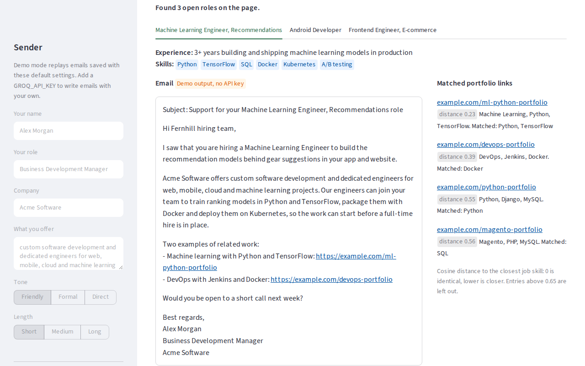
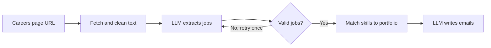

# Cold Mail Generator

A Streamlit app that turns a company's careers page into cold emails. It reads the page, extracts each open role with an LLM on Groq, finds the closest projects in your portfolio with ChromaDB, and drafts one email per role that cites those projects.

It is for business development people at software services companies, who offer their engineers to companies that are hiring.

It has sender settings, validated extraction with a retry, visible portfolio matches, a demo mode that needs no API key, and tests.



## How it works



1. **Read the page.** The app downloads the page, removes scripts, styles, menus and footers, cleans the text and caps it at 12,000 characters. It explains the problem when a URL is not valid, a site blocks the request, or a page has no readable text (for example, a page that loads its jobs with JavaScript).
2. **Extract the jobs.** An LLM on Groq returns the job postings as JSON with `role`, `experience`, `skills` and `description`. A pydantic schema checks the answer. If the JSON is broken or does not fit the schema (for example, a job has no role), the app sends the error back to the model and tries once more.
3. **Match the portfolio.** Each skill is compared with the tech stacks in `data/my_portfolio.csv`, which are embedded in ChromaDB. The app takes the two closest entries per skill, merges them into one row per link, and drops matches with a cosine distance above 0.65.
4. **Write the email.** A second prompt writes the email as you (name, role, company, what you offer, tone and length) and tells the model to cite only the matched links. The app writes emails for up to 10 roles per page.

In demo mode, a bundled sample page replaces the download, and saved outputs replace the two LLM calls. Everything else runs the same way.

## What this version adds over the first version

| Area | First version | This version |
| --- | --- | --- |
| Sender | Hard-coded in the prompt as Mohan, a business development executive at AtliQ | Sidebar inputs for name, role, company, offer, tone and length, with defaults |
| Extraction | The model's JSON is parsed as is. A bad answer stops the run with "Context too big" | pydantic schema, one retry with the error sent back, readable errors for bad URLs, blocked pages and pages with no jobs |
| Page text | Whole page on one line, all punctuation removed (C++ becomes C) | Scripts, menus and footers removed, one line per block, tech names such as C++, C# and Node.js kept, capped at 12,000 characters |
| Portfolio match | Two links per skill passed to the prompt, with repeats, not shown | One row per link, with the skills that found it and the cosine distance, shown next to the email. Weak matches dropped |
| Portfolio store | Built once. After editing the CSV, delete `vectorstore/` | Follows edits to the CSV on the next start |
| No API key | The app stops with an error at start | Demo mode on a bundled sample page, labelled "Demo output, no API key" |
| Libraries and model | LangChain 0.2, `WebBaseLoader` from `langchain-community`, `llama-3.1-70b-versatile` (retired by Groq) | `langchain-core` 1.6, requests and BeautifulSoup, `openai/gpt-oss-120b` by default (set `GROQ_MODEL` to change it) |
| Tests | None | pytest tests with LangChain's fake chat models, so they need no key and no network |
| Layout | App, notebooks and images in one nested folder, the portfolio CSV in two places | `app/`, `data/`, `notebooks/`, `docs/` and `tests/` at the root, one CSV |

## Run it

You need Python 3.12 and [uv](https://docs.astral.sh/uv/). From the repository root:

```bash
uv venv --python 3.12
source .venv/bin/activate
uv pip install -r requirements.txt
```

### Without an API key (demo mode)

```bash
streamlit run app/main.py
```

Open http://localhost:8501 and press **Write emails**. With no `GROQ_API_KEY`, the app reads `data/samples/sample_careers_page.html`, a careers page for a fictional company, and replays the saved outputs in `data/samples/demo_outputs.json` for the two LLM steps. Page cleaning, job validation and portfolio matching run for real. Each email is labelled "Demo output, no API key". The saved outputs were written for this demo; they are not live model output, and the sender settings are fixed in demo mode.

On the first run, ChromaDB downloads its embedding model (all-MiniLM-L6-v2, about 80 MB) to `~/.cache/chroma`. After that, demo mode works offline.

### With a Groq API key

Get a key at https://console.groq.com/keys, then:

```bash
cp .env.example .env    # then replace the placeholder with your GROQ_API_KEY
streamlit run app/main.py
```

Paste the URL of a careers page or a single job posting, fill in your details in the sidebar, and press **Write emails**.

| Variable | Required | Purpose |
| --- | --- | --- |
| `GROQ_API_KEY` | For live mode | Groq API key. If it is missing or still the placeholder, the app runs in demo mode. |
| `GROQ_MODEL` | No | Any current model id from https://console.groq.com/docs/models. Default: `openai/gpt-oss-120b`. |
| `USER_AGENT` | No | User-Agent header for page downloads. |

To use your own portfolio, edit `data/my_portfolio.csv` (columns `Techstack` and `Links`). The store in `vectorstore/` picks up the changes on the next start.

### Run the tests

```bash
uv pip install -r requirements-dev.txt
pytest
```

The tests use LangChain's fake chat models in place of Groq and a small offline embedding in place of ChromaDB's model, so they need no API key and no network. They cover text cleaning, page errors, job parsing and the retry, sender settings in the prompt, portfolio matching, the full pipeline, and a headless run of the app in demo mode. One more test checks that the saved demo emails cite only links that the real embedding model matches; it is skipped when that model is not downloaded yet.

## Project layout

```
app/
    main.py                Streamlit UI
    pipeline.py            The steps for one page, from HTML to emails
    chains.py              Prompts, job schema, extraction with retry, email writing
    portfolio.py           ChromaDB store and portfolio matching
    utils.py               Page download and text cleaning
    demo.py                Demo mode: sample page and saved outputs
data/
    my_portfolio.csv       Portfolio: one tech stack and link per row
    samples/               Sample careers page and saved demo outputs
notebooks/                 Exploration notebooks, with their recorded outputs
docs/                      Screenshot and architecture diagram
tests/                     pytest tests and their offline fakes
.streamlit/config.toml     Theme, usage statistics off
.env.example               Settings to copy into .env
pyproject.toml             pytest settings
requirements.in            Direct dependencies
requirements.txt           Every package pinned for Python 3.12 (compiled by uv)
requirements-dev.txt       requirements.txt plus pytest
LICENSE                    MIT licence
```

## About the notebooks

The three notebooks in `notebooks/` keep their recorded outputs: a first Groq call, ChromaDB basics, and the full walkthrough on a Nike job posting. They were run with `llama-3.1-70b-versatile`, which Groq has since retired, and they use `WebBaseLoader` from `langchain-community`. To run them again from `notebooks/`, change the model name to a current one, install `langchain-community` and `jupyter`, and export `GROQ_API_KEY` in your shell (the notebooks do not read `.env`). The app needs none of this.

## Licence

MIT. See [LICENSE](LICENSE).
